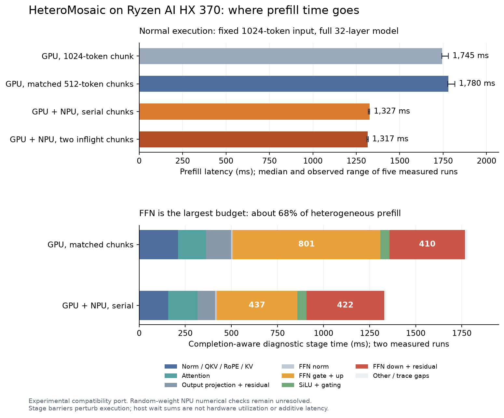

# HeteroMosaic latency and bottleneck report

Measurements: October 14, 2026; report completed October 15, America/Chicago.
**Measured on AUP; experimental runtime port.**

The FFN is the main prefill target: it accounts for about **68% of completion-aware
stage time**. The heterogeneous configuration reduces prefill latency relative to
a GPU configuration with matching chunks, but the down projection remains on the
GPU and is almost as expensive as gate and up combined. Increasing chunk concurrency
provides little additional benefit on this two-chunk workload.

These are provisional performance measurements. The unresolved random-weight NPU
numerical mismatch still prevents treating this as a validated research baseline.
Matching eight greedy tokens is useful regression evidence, not a model accuracy test.

## Workload and method

- Ryzen AI 9 HX 370/Radeon 890M, native `gfx1150`, Strix NPU; existing ROCm 7.2,
  Torch 2.11.0+rocm7.2, XRT 2.26 and the October 13 compatibility patch.
- Source HEAD `61714a3147f34857aa5dfef21a28e762777a2df0`, with the previously
  recorded build/runtime adaptations. No new inference algorithm was implemented.
- Full 32-layer Llama 3.1 8B AWQ; pinned weight revision
  `db1f81ad4b8c7e39777509fac66c652eb0a52f91`. Batch one, 1,024 input tokens,
  eight greedy output tokens, context capacity 1,536; same input as the previous run.
  Input SHA256: `2c11d2476f8b0d68744bec04b88ae434fa2c7f2e1f15a66f6db8785ec5e481c7`.
- Each normal configuration loaded the model once, ran one excluded warmup,
  then five measured generations. Calls synchronize the GPU at their boundaries.
  Setup/loading took 31–35 seconds and is excluded from the latency table.
- The GPU comparison includes both its shipped chunk setting (one effective
  1,024-token chunk here; configured limit 2,048) and a controlled 512-token setting.
  The pipeline experiment retains the serial heterogeneous group's exact kernel
  partitions and changes inflight chunks from one to two.
- Separate diagnostics used two measured calls after warmup: synchronized stage
  scopes for serial execution, ordinary host scopes for the pipeline, NPU host-phase
  timestamps, and timed ioctls. Two additional GPU kernel traces used Torch/Kineto.
  Diagnostic runs are kept separate from the normal latency samples.

All 20 measured normal calls produced the previous GPU token sequence, as did all
40 calls recorded in the JSON results including warmups and diagnostics. Each traced
heterogeneous generation executed **288 prefill NPU submissions and 224 decode
submissions**, with successful completion waits. The two measured calls per tracing
configuration therefore cover 576 prefill and 448 decode submissions, excluding warmup.

## Normal execution latency

Medians; prefill range is the observed minimum–maximum of five calls, not a confidence interval.

| Configuration | Prefill, ms (range) | Decode loop, ms | Decode ms/step | Complete generation, ms |
|---|---:|---:|---:|---:|
| GPU, shipped chunk setting | 1,745.1 (1,743.1–1,781.2) | 423.7 | 60.5 | 2,169.3 |
| GPU, matching 512-token chunks | 1,780.2 (1,777.3–1,818.1) | 415.3 | 59.3 | 2,196.7 |
| Heterogeneous, serial 512-token chunks | 1,327.3 (1,319.7–1,327.8) | 439.9 | 62.8 | 1,766.8 |
| Heterogeneous, two inflight chunks | 1,316.6 (1,312.1–1,318.6) | 444.9 | 63.6 | 1,761.9 |

The first output token comes from prefill; the decode loop performs **seven** further
forward passes. Prefill is not an exact measurement of time to first visible token.
Medians of separate columns need not sum exactly to the median total.

On this fixed workload, serial heterogeneous prefill is **25.4% lower in latency**
than GPU with matching chunks; complete generation is 19.6% lower. Decode is about
5.9% slower. Relative to serial heterogeneous execution, two inflight chunks reduce
median prefill by only **0.8%**, and complete generation by **0.3%**. This does not
establish a useful general pipeline improvement. An early status update based on
partial observations suggested a regression; the completed samples supersede it.

These comparisons are conditional on this software port, workload and configuration;
they are not a general speedup claim across prompts, machines or accurate model outputs.

## Where prefill time goes

The following table is the median sum across 32 layers and two chunks in the
**synchronized serial diagnostic**, whose total prefill is 1,340.8 ms.
Synchronization makes boundaries completion-aware but changes execution.

| Stage | GPU, matched chunks (ms) | Heterogeneous (ms) | Heterogeneous share |
|---|---:|---:|---:|
| Input norm, Q/K/V, RoPE and KV writes (`G1`) | 210.4 | 158.5 | 11.8% |
| Attention (`A`) | 152.6 | 158.0 | 11.8% |
| O projection, layout handling and residual | 135.9 | 95.0 | 7.1% |
| FFN normalization | 8.9 | 9.0 | 0.7% |
| FFN gate and up projections, including branch waits | 800.7 | 437.1 | 32.6% |
| FFN SiLU and elementwise multiplication | 49.4 | 49.4 | 3.7% |
| FFN down projection and residual | 409.9 | 422.2 | 31.5% |
| Other work and trace gaps | 12.5 | 11.6 | 0.9% |

The FFN totals **917.7 ms, or 68.4%**. Its matrix projections alone account for 64.1%.
The existing `G2` label includes O projection as well as the FFN; it is not an FFN timer.
The nested stages above split that parent and must not be added to `G2` again.

**Measured bottleneck:** gate/up benefit strongly from heterogeneous execution;
down remains a large GPU-only operation. Attention is meaningful at about 12%,
but the current workload's larger opportunity lies in FFN matrix execution and placement.

Deleting the entire measured GPU SiLU/gating stage would remove only about 3.7%
of traced prefill latency (roughly 1.04× speedup). That is a rough upper bound for
a pointwise-only change, **not** a bound on persistent FFNs that also change matrix
placement, reuse or scheduling.

## NPU launch, readiness and completion

These numbers come from low-overhead host timestamps with ordinary asynchronous GPU
execution. The sums are across NPU calls in one generation; **calls overlap other work**.
They cannot be added to the stage table or interpreted as independently removable latency.

| Prefill host interval | Serial (ms summed over calls) | Two inflight (ms summed over calls) |
|---|---:|---:|
| Command construction, including its lock | 18.9 | 19.9 |
| Polling for the GPU readiness event | 1,171.9 | 2,602.3 |
| Waiting for the NPU mutex | 0.5 | 181.5 |
| Submission | 3.2 | 3.5 |
| Completion wait, including driver/device delay | 587.1 | 589.4 |

Each column covers 288 prefill calls per generation. The serial sample is the
untraced instrumentation pass; the pipeline sample uses host stage recording.
Completion-wait time is **not pure NPU execution time**. Hardware utilization,
DRAM bandwidth, cache misses, and compute-versus-bandwidth limits were not measured.

The NPU completion budget barely changes with two inflight chunks, while readiness
and mutex waiting increase. This supports prioritizing dependency-aware placement
and scheduling rather than simply adding host concurrency. The polling code spins
on `hipEventQuery`, so these are also CPU activity intervals, not transfer times.

For example, serial NPU gate calls wait about **0.17 ms** for readiness, whereas
up calls wait **3.4–3.5 ms**. Q and V readiness waits can be 7–9 ms. Code inspection
shows each operator records an event on the current GPU stream; an event can sit
behind earlier GPU work, including work unrelated to that operator's immutable input.
Some delays are necessary dependencies; others may be conservative ordering.
Changing fences is a **proposed investigation**, not a proven speedup: removing a
readiness wait can merely move that time into the NPU queue.

Command construction is only about 1.4% of normal serial prefill in this diagnostic.
Caching packets may be useful later, but the data do not make it the first optimization.
The unsupported legacy wait probe costs under 1 ms over a generation in the ioctl
trace; it is also a low priority compared with projection execution.

## Decode and GPU kernel evidence

The heterogeneous configuration is not faster for decode here. Only the gate GEMV
uses the NPU, giving 224 calls over seven steps. The shipped down GEMV requests
`cpuN + npuN = 5120` for an output width of 4096 and falls back to the GPU; there
are 224 corresponding warnings per normal generation. The Q GEMV configuration
also assigns 1,152 output channels to CPU work. Thus heterogeneous decode is not a
pure GPU–NPU comparison, despite `cpu_decode=false`.

In the synchronized diagnostic, heterogeneous decode's gate/up stage totals
191.9 ms and down totals 95.2 ms over seven steps. Forced stage barriers increase
decode latency about 10%, so these are diagnostic costs, not a reconstruction of
the normal 439.9 ms decode loop.

Separate GPU traces corroborate that packed W4A16 matrix kernels dominate GPU time.
They record 448 prefill GEMM launches in the matched GPU configuration versus 416
in serial heterogeneous execution; full NPU Q offload removes 32 GPU launches.
The vocabulary projection kernel runs eight times and totals about 83 ms, or
10.4 ms per call. This plausibly accounts for most time outside the decoder-layer
stages, but its contribution to decode is inferred from a separate trace.

Kineto slowed the GPU-only traced prefill from about 1.786 s to 2.112 s and emitted
a ROCTracer duplicate-flow warning. Use those traces for kernel identity/counts and
qualitative attribution, not as the normal latency benchmark or a memory-bandwidth diagnosis.

## Implications for HeteroMega

1. **Keep correctness as the first gate.** Resolve the packed NPU numerical
   mismatch with signed activations and real-weight layer comparisons. Audit
   configurations and make fallback explicit before using speedups as research results.
2. **Target the complete FFN, particularly down projection.** First measure an
   isolated 512-token FFN with hidden size 4096 and intermediate size 14336.
   Establish unchanged GPU and M-split references, then test a supported down-offload
   configuration as a separate ablation. This distinguishes device placement gains
   from gains caused by persistence.
3. **Test persistence against the actual baseline.** Current M-split outputs occupy
   shared output regions; there is no obligatory concatenate to remove. The active
   chunk policy does not select a prefill K-split down path. Persistent channel
   partitions would introduce a partial-output sum at the FFN boundary. Their value
   must come from measured placement, dataflow, reuse or scheduling improvements.
4. **Use one feasible unequal split before tuning ratios.** A proposed feasibility
   case is 4096 NPU intermediate channels plus 10240 GPU channels. Its NPU gate/up
   and down matrix shapes are all 512×4096×4096, reusing a staged NPU shape family.
   This still needs repacked weights, compatible branch layouts, a SiLU/gating
   strategy and numerical validation; it is not an asserted optimal split.
   Persistent token-row ownership remains an important comparison because it avoids
   the channel split's partial-output sum.
5. **Investigate readiness and interference with controlled experiments.** Preserve
   the same splits and compare one versus two inflight chunks. Measure GPU completion
   with events, and separate input readiness, NPU queueing and completion. Expand
   prompt lengths only after the fixed-shape correctness and profiling harness is
   stable. Two chunks at 1024 tokens do not settle behavior at longer contexts.

## Reproduction, evidence and limits

The reusable runner, instrumentation script and analyzer are in
[runs/2026-10-14-profile/](runs/2026-10-14-profile/). Read its
[README](runs/2026-10-14-profile/README.md) for commands. Raw configs, per-call
results/logs, JSONL stage traces, NPU/DRM timing CSVs, profiler tables and
`analysis.json` are in [evidence/](runs/2026-10-14-profile/evidence/).
The large raw GPU traces are losslessly compressed as `gpu-kernel-traces.zip`.

The instrumented source and module were temporary cloud artifacts. The baseline
source and module were restored, followed by a normal extension rebuild. No host
drivers, firmware, model weights or inference algorithms changed; no dependencies
were installed and no commits/pushes were made.

Stage barriers added about 1% to serial heterogeneous prefill and about 10% to its
decode loop. Unsynchronized pipeline stage durations are host intervals, can overlap,
and can charge GPU work to later waits; they must not be compared directly with
synchronized stage durations. NPU phase sums similarly exceed elapsed time when
multiple host workers wait concurrently. Five within-process samples on one shared
cloud host are a useful first profile, not a frequency-controlled statistical study.

Key code locations (code-confirmed): `forward_llama3_with_scratch` and `generate`
in `src/unified_llm_w4a16_hetero/unified_llm_w4a16.cpp`;
`hetero_matmul_out_gemm_packed_M` in `hetero_compute.cpp`;
`get_split_type`, configuration selection and `npuMatmul_zero` in `npuSetup.cpp`.
