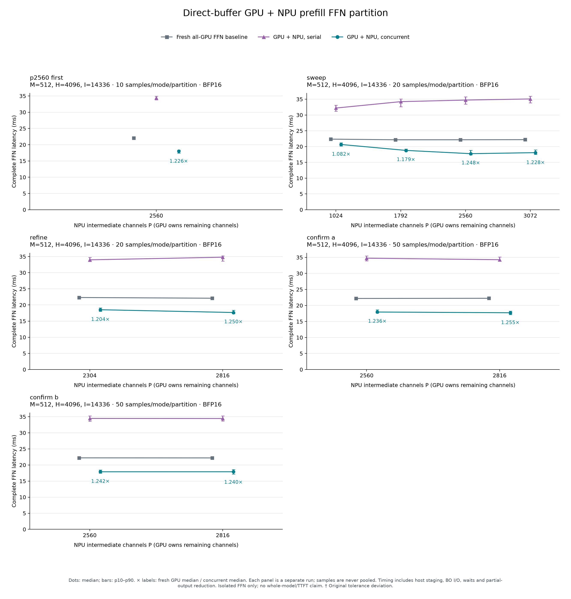

# Direct-buffer GPU + NPU prefill FFN partition

**Measured, October 27, 2026:** the optimized eight-column BFP16 NPU branch
accelerates the complete FFN microbenchmark by **1.236–1.255×**, or
**19.1–20.3% lower latency**, versus matched HeteroMosaic GPU-only FFN kernels.
The useful tested region is **P2560–P2816** out of 14336 intermediate channels
(17.9–19.6% on the NPU). All original numerical tolerances and execution checks
pass. The two longer confirmation runs reverse which split is fastest; they
support a useful region, not a unique optimum.

This measures GPU-ready input through synchronized GPU output, including
host staging, NPU BO I/O, activation layouts, waits and the partial-output sum.
It is an isolated FFN result. Attention, normalization, residual, model
scheduling, complete prefill/TTFT and the native heterogeneous HeteroMosaic
model are outside this measurement.

## Confirmation

Each row has 50 timed samples per mode after three excluded warmup rounds.
Baseline, serialized partition and concurrent partition are interleaved in
seeded shuffled order. The second process reverses the partition order.
M512/H4096/I14336, batch one, identical synthetic W4A16 group128 weights and
alternating BF16 inputs are used throughout. Times are medians in milliseconds.

| Run/order | NPU / GPU channels | GPU-only | Serial partition | Concurrent partition | Speedup | Latency reduction |
| --- | ---: | ---: | ---: | ---: | ---: | ---: |
| A, first | 2560 / 11776 | 22.179 | 34.751 | 17.947 | 1.236× | 19.08% |
| A, second | 2816 / 11520 | 22.233 | 34.276 | 17.721 | 1.255× | 20.29% |
| B, first | 2816 / 11520 | 22.200 | 34.446 | 17.897 | 1.240× | 19.38% |
| B, second | 2560 / 11776 | 22.219 | 34.472 | 17.888 | 1.242× | 19.49% |

Concurrent p10–p90 intervals are 17.617–18.659 and 17.191–18.257 ms in A,
and 17.176–18.579 and 17.454–18.479 ms in B, in the row order above. These
describe sample spread, not confidence intervals. Separate runs are not pooled.
P2560 remains a reasonable integration setting because its existing packaged
artifacts are available and P2816 does not show a repeatable advantage.

Raw reports: [confirmation A](results/confirm_a.json),
[confirmation B](results/confirm_b.json). The
[derived summary](analysis/summary.json) retains raw-sample statistics,
errors and diagnostic semantics separately for every report.

## Partition search

The initial sweep and neighboring refinement each use 20 samples per mode and
partition, after three warmups. Every split has a fresh GPU-only control.

| Report | NPU channels | GPU-only, ms | Concurrent, ms | Speedup |
| --- | ---: | ---: | ---: | ---: |
| Sweep | 1024 | 22.352 | 20.657 | 1.082× |
| Sweep | 1792 | 22.146 | 18.782 | 1.179× |
| Refinement | 2304 | 22.315 | 18.527 | 1.204× |
| Sweep | 2560 | 22.150 | 17.750 | 1.248× |
| Refinement | 2816 | 22.093 | 17.668 | 1.250× |
| Sweep | 3072 | 22.188 | 18.073 | 1.228× |

Raw reports: [sweep](results/sweep.json), [refinement](results/refine.json).
The earlier [ten-sample P2560 run](results/p2560_first.json) measured
22.071→18.008 ms. It is retained separately from the longer confirmations.
The [M128/H256/I1024/P512 smoke test](results/smoke.json) passes correctness
but is slower than its tiny GPU control; it is a functional check.



[Exportable PDF](analysis/latency_comparison.pdf).

## Implementation and weights

The benchmark entry point is
[`run_upstream_partition.py`](../../../experiments/ffn_partition/run_upstream_partition.py),
committed as `f3e109e` on `codex/upstream-gpu-npu-partition`. The NPU kernel is
the same direct-buffer BFP16 implementation published in kernel-only PR #3,
package `fd67fbf`. This experiment does not modify or merge that PR.

The NPU owns the prefix `[0,P)` and the GPU its complement `[P,14336)`.
Both keep matching gate/up channel ownership through SiLU and multiplication;
down consumes the corresponding K slice. The two BF16 down partials are
summed once on the GPU. The GPU branch is enqueued before blocking NPU waits;
the serialized control uses the same kernels and data handling with a GPU
completion wait before starting NPU work.

To prepare the NPU's synthetic source buffers, each full canonical weight
matrix is packed once into the original glassescrab **4352-byte K128/N64
layout** during setup. These full original arrays are passed unchanged to
the NPU; graph DMA uses full source dimensions to select the channel slice.
The GPU baseline adapter independently packs the same canonical matrices;
hashes of its actual device buffers match the NPU source bytes exactly.
The GPU suffix is also prepared during setup from the same canonical values.
There is no NPU compact-weight conversion or requantization. CPU tests
independently check nibble/metadata addresses, uneven stripes and complementary
down/gate/up slices.

Original weights are uploaded into separate GPU/NPU buffers. Shared system
DRAM does not make this adapter zero-copy or eliminate weight-buffer copies.
Gate/up remain on chip through NPU SwiGLU, but Z is still host-staged between
SwiGLU and down. Persistent partition ownership is distinct from on-chip
residency across those two launches.

The NPU profile uses eight columns/32 workers, BFP16-backed 8×8×8 MMUL with
BF16 I/O and FP32 K-group partials, vector zero metadata, MMUL M blocking1,
SwiGLU reuse2/A-depth2/row-major input/down-A output, down reuse4/A-depth1,
two-segment DMA scheduling and borrowed intermediate readback. Final output
is independently unpacked. Arithmetic/source/layout manifests are checked
before every artifact is reused.

The GPU control uses HeteroMosaic's packed GEMMs with separate BF16 SiLU and
multiply. It does not invoke the teammate's merged-gate/up and fused-pointwise
GPU FFN frontend. Both teammate PR heads are ancestors of this checkout;
their separate frontend remains an additional comparison to perform.

## Correctness and audit

The explicit BFP16 report policy retains the original limits: relative L2
≤0.02 and maximum absolute error ≤0.05 + 0.03×reference maximum. This maximum
bound is tensor-normalized, not an elementwise relative-error guarantee.
GPU-only and GPU partial checks are always strict. Nonfinite, stale, zero,
repeatability, upload-count and completion failures remain fatal.

All **3702 saved numerical checks pass**, with no structural failure.
Across all reports, the worst relative L2 is **0.01723916**, on an NPU partial.
For the two confirmation reports specifically:

| Comparison | Worst relative L2 | Maximum absolute error |
| --- | ---: | ---: |
| Complete output vs partitioned BF16 CPU oracle | 0.00805410 | 0.03125 |
| Complete output vs GPU-only output | 0.00811544 | 0.0390625 |
| NPU partial vs its BF16 CPU oracle | 0.01723916 | 0.03515625 |

Signed varied inputs, changed inputs, exact zero and repeated inputs are
checked before timing. Timed calls alternate inputs, validate outputs and
both partials outside the timer, and verify counts after every candidate
call. Every NPU branch uploads each fixed weight once. Original full-buffer
hashes remain unchanged. Outputs for identical fixtures also match exactly
across separate processes in the retained reports.

The independent [audit](audit.json) verifies **1656 successful NPU dispatches**,
996 timed FFN invocations, 102 warmup invocations and 96 candidate validation
calls. It checks 3094 archived file hashes, 14 NPU artifact pairs, the GPU build
fingerprint, source versions, counters, sample statistics and numerical verdicts.
It recalculates tolerance decisions from saved error magnitudes; raw output
arrays are not exported, so it cannot independently recompute those magnitudes.
These synthetic checks do not establish pretrained-model accuracy.

## Remaining costs

In the longer confirmations, the concurrent NPU host-branch interval is
15.30–15.58 ms, compared with 14.78–14.88 ms in the serialized control.
Concurrent SwiGLU launch-plus-wait is 7.26–7.49 ms and down is 5.21–5.24 ms.
Final CPU output layout conversion still takes about 0.98–1.35 ms. GPU-to-host
input staging is about 0.26 ms; the final output-stage/completion interval is
1.32–2.03 ms and also includes any remaining GPU wait.

These are overlapping host intervals and separate medians, so they must not
be summed into device time. Their increase under concurrent execution is
measured; attributing it specifically to DRAM contention requires further
device profiling. The final boundary interval does not isolate copy/reduction
cost or identify which accelerator finishes last. The observed flattening
near P2560–2816 motivates retaining that region for integration and measuring
attention interference before choosing a model-wide ratio.

## Environment and reproduction

Hardware: AMD Ryzen AI 9 HX370, Radeon 890M `gfx1150`, Strix NPU. This is not
a Ryzen AI Max+395 measurement. NPU power mode is `default` before and after;
both boundary snapshots show no leftover hardware contexts. Runtime:
Torch 2.11.0+rocm7.2, ROCm 7.2.26015, NumPy 1.26.4, XRT/MLIR-AIE from the
prepared AUP environment, compiler commit
`7e00b57955e108fe9d8e9419f5828a0c7e650858`.

The initial container lacked exposed GPU devices. Creating local device nodes
did not resolve its device-access restriction. Restarting the idle notebook
through AUP's normal controls restored GPU/NPU allocation; real GPU arithmetic
then passed. No host driver, kernel or firmware was changed. See
[environment](results/environment.txt),
[initial device probe](results/device_before_restart.txt) and power/context
snapshots in `results/`.

The isolated cloud overlay is `/notebooks/HeteroMega-upstream-partition-20261027`.
Earlier overlays and kernel baselines remain intact. From a source checkout
with the prepared ROCm and IRON environments:

```bash
export OPENBLAS_NUM_THREADS=1 OMP_NUM_THREADS=1
export IRON_PYTHON=/home/mliraie/mlir-aie/ironenv/bin/python
export HETEROMEGA_ROCM_PATH=/opt/rocm-7.2.0 ROCM_PATH=/opt/rocm-7.2.0
export PATH=/notebooks/heteromega-ffn-venv/bin:$PATH
# Preserve the notebook's MLIR-AIE/XRT PYTHONPATH and LD_LIBRARY_PATH.
mkdir -p results
python -m experiments.ffn_partition.run_upstream_partition \
  --m 512 --npu-channels 1024,1792,2560,3072 --warmup 3 --iterations 20 \
  --artifact-root artifacts --output results/sweep.json
python -m experiments.ffn_partition.run_upstream_partition \
  --m 512 --npu-channels 2304,2816 --warmup 3 --iterations 20 \
  --artifact-root artifacts --output results/refine.json
python -m experiments.ffn_partition.run_upstream_partition \
  --m 512 --npu-channels 2560,2816 --warmup 3 --iterations 50 --no-build \
  --artifact-root artifacts --output results/confirm_a.json
python -m experiments.ffn_partition.run_upstream_partition \
  --m 512 --npu-channels 2816,2560 --warmup 3 --iterations 50 --no-build \
  --artifact-root artifacts --output results/confirm_b.json
```

Compilation, initial weight preparation/uploads, setup allocations, reference
evaluation and validation output readback are excluded from timing. Activation
layouts, BO writes/reads and synchronization inside each invocation are included.
The build-only option needs no GPU; ordinary runs preflight a real GPU operation
before compiling. Local verification passes **29 focused CPU tests**.

[Hardware evidence archive](hardware-evidence.tar.gz), 10254467 bytes, SHA256:
`7dce9df12b0cac63ed9196cf1c510e1450c00adcff393ba48c21fbeef6b4d4d8`.
It contains raw reports/logs, sources, compiled NPU projects, GPU shared library,
build metadata and an exhaustive hash manifest. The smoke/first-run driver
differs from the final driver only in an exclusion-description string; both
source archives are retained. Exact source provenance is recorded in
[source_provenance.json](source_provenance.json).

```bash
tar -xzf hardware-evidence.tar.gz -C /tmp
python audit.py --evidence-root /tmp/upstream-partition-evidence-20261027 \
  --archive hardware-evidence.tar.gz --output audit.json
python analyze.py --results-dir results --output-dir analysis
```

The audit needs NumPy; plotting additionally needs Matplotlib. Next: integrate
the verified partition into the existing prefill schedule, preserve attention
and chunking controls, and measure complete prefill with real model weights.
