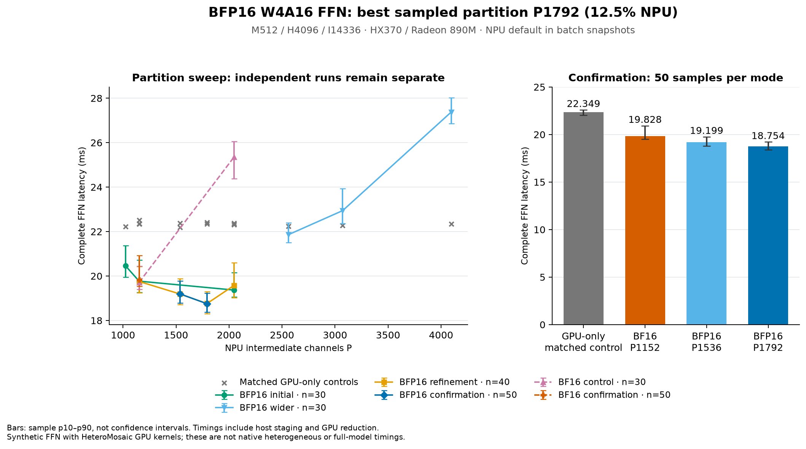
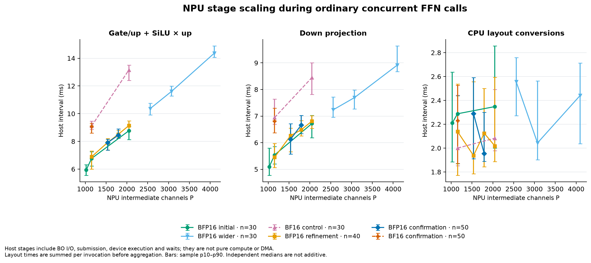

# BFP16 W4A16 prefill FFN measurements — 2026-10-22

For the follow-up source trace, additive cost attribution, DMA replay counts
and optimization priorities, see [NPU_IMPLEMENTATION_TRACE.md](NPU_IMPLEMENTATION_TRACE.md).

**Measured:** the TileFuse-derived BFP16 projection kernel executes in the
existing eight-column fused SwiGLU FFN. The best sampled allocation is
**P1792/14336 (12.5% NPU)**. A 50-sample repeat measured **18.754 ms**, against
its **22.349 ms GPU-only control**: **1.1917×, or 16.1% lower latency**.
A fresh native-BF16 P1152 control measured **19.828 ms** with a nearly identical
22.351 ms GPU control; the selected BFP16 path is **5.4% lower in latency**.
These are observations on this workload, not confidence intervals or a
globally optimal partition claim.

The control uses original HeteroMosaic **GPU-only** W4A16 kernels. This is not
a comparison against native HeteroMosaic's heterogeneous scheduler, a whole
model, attention interference, TTFT, or the proposed Max+395 machine.
The previously documented native model library and baseline checkout were
absent at their recorded paths in this restarted notebook; their comparison
remains outstanding.

## Platform and implementation

- AUP Ryzen AI 9 HX370 / Radeon 890M / Strix eight-column AIE2P NPU.
- NPU power reported **`default`** before the batch, after the initial
  comparisons, and after confirmation. The authorized `performance` switch
  returned permission error 13. No driver or host-kernel changes were made.
- Existing ROCm/Torch runtime, NumPy 1.26.4, and MLIR-AIE compiler revision
  `7e00b57955e108fe9d8e9419f5828a0c7e650858` were reused.
- Upstream kernel strategy is pinned to
  `glassescrab/mlir-aie@121dd54abc68f84d89a7074372ebf82be2db62d5`.
  The [adaptation document](../../npu/ffn/BFP16_ADAPTATION.md) records all
  seven inspected branch heads and why this corrected W4A16 source was chosen.
- `aie::mmul<8,8,8,...>` uses the BFP16 unit with four accumulators. W4 weights,
  BF16 tensors, compact tile packing, FP32 K-group partials, and the eight-column
  schedules remain intact. Worker stacks are 4096 bytes in BFP16 mode.
- Matching gate/up channel slices remain local through on-chip NPU SiLU and
  multiplication. Down is still a separate NPU graph with host staging and
  a CPU layout permutation. The GPU adds the two devices' partial outputs.
  There are two NPU launches per FFN invocation.

## Workload and measurement boundary

All model-shaped cases use M512/H4096/I14336, unsigned W4A16 group128,
seed12832, the same canonical synthetic weights and two alternating BF16
inputs. A zero input and a repeated input also precede timing. Three warmups
are excluded. Each partition interleaves GPU-only, serial-partition and
concurrent-partition calls; ordinary runs use 30, 40 or 50 samples per mode.

Ordinary wall time starts with ready GPU input and ends with synchronized GPU
output. It includes orchestration, dynamic copies, packing/layout conversions,
NPU launches/waits, and final GPU reduction. Compilation, fixed-weight upload,
reference calculations and validation readbacks are excluded. Diagnostics
use separate runs with GPU events and host probes; their medians must not be
substituted for ordinary latency or added across overlapping devices.

The final refinement/confirmation harness additionally checks every timed GPU
partial strictly outside the timing boundary. Earlier runs already checked
GPU partials during preflight and every timed GPU-only control strictly.
Both harness versions are archived; kernels and measured boundaries are the same.

## Allocation sweep and repeat

Medians in milliseconds. Repeated runs are kept separate. P10–P90 bars in the
plots show sample spread, not confidence intervals.

| Arithmetic | Run | NPU channels | NPU share | Concurrent FFN | Matched GPU control |
| --- | --- | ---: | ---: | ---: | ---: |
| BFP16 | Initial, 30 samples | 1024 | 7.14% | 20.458 | 22.231 |
| BFP16 | Initial, 30 samples | 1152 | 8.04% | 19.769 | 22.363 |
| BFP16 | Initial, 30 samples | 2048 | 14.29% | 19.368 | 22.372 |
| BFP16 | Wider, 30 samples | 2560 | 17.86% | 21.860 | 22.244 |
| BFP16 | Wider, 30 samples | 3072 | 21.43% | 22.943 | 22.284 |
| BFP16 | Wider, 30 samples | 4096 | 28.57% | 27.377 | 22.339 |
| BF16 | Control, 30 samples | 1152 | 8.04% | 19.716 | 22.339 |
| BF16 | Control, 30 samples | 2048 | 14.29% | 25.357 | 22.315 |
| BFP16 | Refinement, 40 samples | 2048 | 14.29% | 19.580 | 22.333 |
| BFP16 | Refinement, 40 samples | 1792 | 12.50% | 18.761 | 22.408 |
| BFP16 | Refinement, 40 samples | 1536 | 10.71% | 19.194 | 22.369 |
| BFP16 | Refinement, 40 samples | 1152 | 8.04% | 19.755 | 22.509 |
| BFP16 | Confirmation, 50 samples | 1536 | 10.71% | 19.199 | 22.193 |
| **BFP16** | **Confirmation, 50 samples** | **1792** | **12.50%** | **18.754** | **22.349** |
| BF16 | Confirmation, 50 samples | 1152 | 8.04% | 19.828 | 22.351 |

The P1792 confirmation's P10–P90 is **18.375–19.225 ms**; the BF16 P1152
control's is **19.531–20.932 ms**. At fixed P2048, BFP16 is 23.6% lower in
latency than BF16 in the initial controls. That larger fixed-partition gain
is not the gain against a retuned BF16 implementation; the latter is 5.4%
in confirmation. The useful effect is allowing a larger NPU share before
the NPU branch becomes the bottleneck.



## Separate stage profiles

These are diagnostic medians, in milliseconds. The fixed-P2048 comparison
uses ten samples; P1792 uses fifteen. GPU values are HIP event durations;
NPU launch/wait and branch values are host durations.

| Measurement | BF16 P2048 | BFP16 P2048 | BFP16 P1792 |
| --- | ---: | ---: | ---: |
| NPU SwiGLU host wait | 12.625 | 8.516 | 7.886 |
| NPU down host wait | 7.481 | 5.833 | 5.328 |
| NPU SwiGLU host submit | 0.091 | 0.096 | 0.098 |
| NPU down host submit | 0.117 | 0.144 | 0.143 |
| Outer NPU branch call | 24.215 | 18.792 | 17.848 |
| GPU branch | 18.015 | 17.794 | 18.162 |
| GPU reduction | 0.162 | 0.157 | 0.155 |

At P1792 the CPU input-layout, down-input-layout and output-layout medians
are 0.966, 0.136 and 1.355 ms. Input GPU→host and output host→GPU HIP event
durations are 0.244 and 0.175 ms. The two device branches overlap, so these
numbers do not sum into the complete FFN latency.

**Interpretation:** BFP16 materially shortens the projection-containing NPU
wait intervals. Launch overhead changes little relative to those savings.
At the selected share, the GPU branch and NPU host branch have similar
durations; increasing P further again makes the NPU path too long.
Host layout/staging remains a visible cost. A wait includes runtime, DMA,
compute, stalls and completion; this experiment does not isolate pure NPU
compute cycles, DMA latency or DRAM bandwidth.



[Separate GPU/NPU diagnostic stages](results/bfp16_20261022/plots/stages_m512_h4096_i14336.png)
and [host submission costs](results/bfp16_20261022/plots/submission_m512_h4096_i14336.png)
are also retained.

## Numerical and execution evidence

BFP16 was allowed to report deviations without widening the original limits.
Nevertheless, all successful hardware reports pass the existing numerical
bounds: relative L2 ≤0.02 and maximum absolute error ≤0.05+0.03×reference
maximum. Zero inputs remain exactly zero; changed and repeated inputs pass
the structural checks. This is synthetic numerical validation, not a model
accuracy or perplexity result.

The ten successful reports contain **2,764 completed NPU submissions** and
**1,694 timed invocations**, including the small smoke and separate diagnostics.
For M512, the largest recorded relative-L2 error is **0.0172392** and maximum
absolute error is **0.0390625**. Including the small smoke, those maxima are
0.0180971 and 0.125; their reference scales differ. All remain inside the
unchanged bounds. Locally, **147 CPU tests pass**, including layout, artifact
identity, reporting-policy and rendered-plot checks.

The [recomputed audit](results/bfp16_20261022/plots/audit.json) contains exact
error extrema and their locations, completion counts, source-contract checks,
and per-report evidence. A source build or successful launch alone is not
counted as numerical validation. Binary hashes are retained in manifests;
the local audit checks current graph/kernel contracts and does not claim to
rehash remote binaries it did not download.

## Reproduce the analysis and continue

The [evidence archive](results/bfp16_20261022/evidence.tar.gz) retains raw
reports, compiler logs/manifests, command scripts, power checks, both source
snapshots and initial setup failures. All 97 entries in its embedded SHA256
manifest were checked after download. Archive SHA256:
`1128e38b1e12b3f668d732f558e697d3b4d827d944572622983330246eb1c115`.
Raw JSON includes the isolated overlay's full Git status, which is large;
compressed storage preserves it without duplicating it in version control.

```bash
mkdir -p experiments/ffn_partition/results/bfp16_20261022/raw
tar -xzf experiments/ffn_partition/results/bfp16_20261022/evidence.tar.gz \
  -C experiments/ffn_partition/results/bfp16_20261022/raw
bfp16_source_root=$(mktemp -d /tmp/heteromega-bfp16-source.XXXXXX)
tar -xzf experiments/ffn_partition/results/bfp16_20261022/raw/source/initial-runtime.tar.gz \
  -C "$bfp16_source_root"
tar -xzf experiments/ffn_partition/results/bfp16_20261022/raw/source/final-harness.tar.gz \
  -C "$bfp16_source_root"
python experiments/ffn_partition/results/bfp16_20261022/analyze.py \
  --source-root "$bfp16_source_root" \
  --output-dir /tmp/heteromega-bfp16-reproduced
```

Extract the initial runtime first, then overlay the final harness: the latter
contains six updated host files, not a complete source tree. `--source-root`
selects both imported audit helpers and the graph/kernel files being hashed.
Every archived build contract and expected manifest must still match; a
missing file, source mismatch or import from another tree is an error. Without
this option, the current checkout is audited and later kernel optimizations
correctly fail the historical checks. The output directory above keeps the
recorded figures and numerical summaries unchanged. Keep `bfp16_source_root`
for the trace command in [NPU_IMPLEMENTATION_TRACE.md](NPU_IMPLEMENTATION_TRACE.md#reproduce).

Analysis requires NumPy and Matplotlib; this session used an isolated
`/tmp/heteromega-bfp16-analysis` environment. The live experiment overlay is
`/notebooks/HeteroMega-bfp16-20261022`. Original notebook work was preserved.
The local branch remains `codex/ffn-partition-microbench`; no commit, push or
PR was made.

Next use P1792 as a measured starting candidate for real prefill integration
with the existing attention/chunk schedule. Re-establish the original native
HeteroMosaic baseline separately; do not rename the GPU-only control. Other
prompt sizes, quantization data, platforms and full-model accuracy require
their own measurements. Direct Z-layout output/shared-buffer handoff and
larger upstream-style tiles remain possible optimizations, not measured gains.
