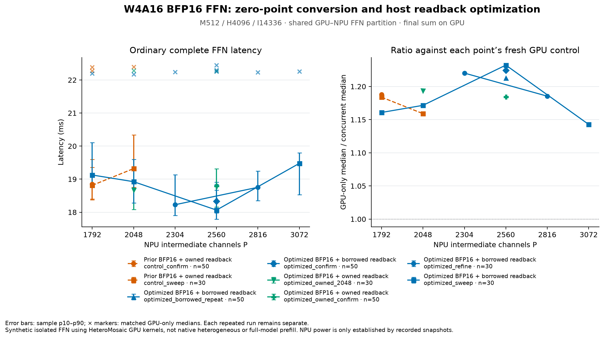
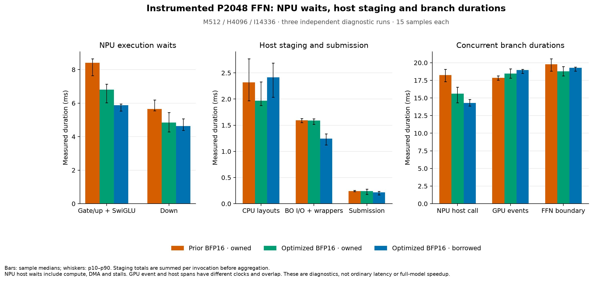

# BFP16 prefill optimization — 2026-10-22

The compiled BFP16 dequantizer made 32 software `__floatunsisf` calls for
each compact W4 tile. Constructing the exact BF16 bits for `128 + zero`
removes all 32 calls without changing the weight arithmetic. At P2048 with
the same owned-readback policy, the measured NPU branch median falls from
18.634 to 15.965 ms in separate diagnostic runs. Complete FFN acceleration
is smaller because GPU execution becomes the critical dependency.

**Measured scope:** synthetic prefill FFN, M512/H4096/I14336, group128 W4A16,
seed12832, eight NPU columns/32 workers, HX370/Radeon890M, NPU **default**
power mode. These are neither whole-model prefill/TTFT nor native
heterogeneous HeteroMosaic results. The fresh GPU-only control uses
HeteroMosaic's packed W4A16 GEMMs from main at `e91c4cb`.

## Complete FFN results

Ordinary timing starts with ready GPU input and ends with synchronized GPU
output. It includes input staging, CPU layouts, XRT write/read/sync, both NPU
launches, output staging, GPU work and the final GPU reduction. Compilation,
fixed-weight upload and reference validation are outside the boundary.
Baseline, serial and concurrent modes alternate in seeded shuffled order.
Every row below has its own fresh GPU control and three warmups.

| Configuration | NPU channels | Samples | Concurrent median | p10–p90 | GPU-only median |
|---|---:|---:|---:|---:|---:|
| Previous BFP16, owned readback | 1792 | 50 | 18.845 ms | 18.372–19.360 ms | 22.388 ms |
| Optimized BFP16, borrowed readback | 2560 | 50 | 18.337 ms | 18.039–18.908 ms | 22.450 ms |
| Optimized BFP16, borrowed repeat | 2560 | 50 | 18.393 ms | 17.982–18.837 ms | 22.304 ms |
| Optimized BFP16, owned readback | 2560 | 50 | 18.800 ms | 18.157–19.317 ms | 22.266 ms |

The selected borrowed-readback configuration is 2.4–2.7% lower latency than
the previous best confirmation, and 17.5–18.3% below its own GPU-only control
(1.21–1.22×). These are observed medians with overlapping distributions,
not confidence bounds or a guarantee of improvement. The six-point borrowed
sweep/refinement covered P1792,2048,2304,2560,2816,3072; P2560 was selected
before the held-out confirmation. It is the best sampled allocation for
this configuration, not a global optimum.

At fixed P2048, keeping owned readback isolates the kernel change: ordinary
median 19.320→18.671 ms (30 samples each, 3.4% lower). The new owned P2560
confirmation is essentially tied with the old best P1792. Report the larger
selected result as a **kernel, readback-policy and partition configuration**
comparison; do not attribute all of it to one code change.



## What changed and what still limits performance

- **Compiled-binary confirmed:** `uint16_t(0x4300 | z)` represents BF16
  `128+z` exactly for the validated unsigned four-bit zero points. Scalar
  lane addressing, scale loads, compact W4 payload, FP32 partials and BFP16
  MMUL remain unchanged. Representative gate/up/down worker ELFs have
  32→0 helper call sites; the xclbin and instruction hashes were rechecked.
- **Measured, owned readback in both runs:** P2048 SwiGLU host wait falls
  8.411→6.807 ms; down wait 5.645→4.843 ms. Outer NPU call falls
  18.634→15.965 ms (14.3%). GPU branch median moves 17.869→18.457 ms.
  Each is a separate diagnostic interval, not an additive latency model.
  Waits contain compute, DMA, runtime and stalls; no device cycle attribution
  or bandwidth-saturation claim is made.
- **Experimental host option:** borrowed read-only BO views remove only the
  extra NumPy ownership copy. XRT read/sync and layout copies remain. Views
  are consumed before reuse; returned branch outputs retain independent
  storage. At P2048, owned/borrowed complete medians were 18.671/18.924 ms;
  at P2560 they were 18.800/18.337–18.393 ms. The effect depends on the
  partition and scheduling. Owned readback therefore remains the conservative
  default; `--borrow-npu-readback` opts into the measured experimental path.
- **Unchanged bottlenecks:** activation replay, sequential M waves, the
  host-mediated Z handoff and GPU/NPU shared-memory interference remain.
  Faster NPU execution can expose GPU latency; the data do not isolate why
  the concurrently running GPU branch changes. Final reduction stays on GPU.
  Increasing fused reuse beyond the SRAM budget is still unsafe.



## Verification and provenance

All 13 benchmark/profile reports pass the original numerical bounds, including
strict GPU checks, changed input, zero output and repeatability. They contain
2,468 successful NPU completions and 1,485 timed invocations. A separate
M512/H4096/I14336/P2048 comparison checks complete output-byte hashes for two
random inputs, zero and repeated input: old and new kernels/readback paths
are **bit-identical** (16 additional completions). Maximum recorded relative
L2 across the reports is 0.0180971; this does not validate real-model accuracy.

The final local CPU suites pass 48 NPU, 105 partition and five teammate
evaluation tests. The native heterogeneous comparison adapter remains
prepared but uncompiled/unmeasured on this restarted host; its presence is
not a native-baseline result. Teammate GPU/evaluation changes are merged
without modifying their source.

The isolated notebook overlays preserve the original BFP16 checkout. Their
copied Git HEAD is not the local PR HEAD; source snapshots, build contracts
and binary hashes identify what actually ran. The final CLI restores owned
readback by default after the experiment. The archived harness default was
borrowed: use the explicit flag below with the final code to reproduce that
policy. The archived `--owned-npu-readback` commands retain their meaning.

Evidence: [compressed archive](results/optimization_20261022/evidence.tar.gz),
[audited summary](results/optimization_20261022/plots/summary.json),
[analysis script](results/optimization_20261022/analyze.py).
Archive SHA256:
`235d7703a25d1835b3ac280a9ddc5869a861062becbc34382b3b463a115ca9f6`.
All 101 archived file checksums were verified after download. The archive
includes source snapshots, manifests, commands, logs, disassembly and selected
ELFs; it excludes weights and credentials. A packaging-only first-attempt
error is retained; it did not rerun or alter benchmark measurements.

```bash
mkdir -p experiments/ffn_partition/results/optimization_20261022/raw
tar -xzf experiments/ffn_partition/results/optimization_20261022/evidence.tar.gz \
  -C experiments/ffn_partition/results/optimization_20261022/raw
python experiments/ffn_partition/results/optimization_20261022/analyze.py \
  --raw-root experiments/ffn_partition/results/optimization_20261022/raw \
  --output-dir experiments/ffn_partition/results/optimization_20261022/plots

# On the configured AMD notebook, with runtime PATH/PYTHONPATH prepared:
python -m experiments.ffn_partition.run --m 512 --npu-channels 2560 \
  --npu-arithmetic bfp16 --fuse-swiglu --borrow-npu-readback \
  --warmup 3 --iterations 50 --iron-python /home/mliraie/mlir-aie/ironenv/bin/python \
  --output experiments/ffn_partition/results/optimized-confirm.json
```

Next measure the selected configuration inside the existing causal prefill
schedule with attention running, and restore the native heterogeneous
baseline. The isolated FFN improvement does not establish end-to-end model
acceleration.
