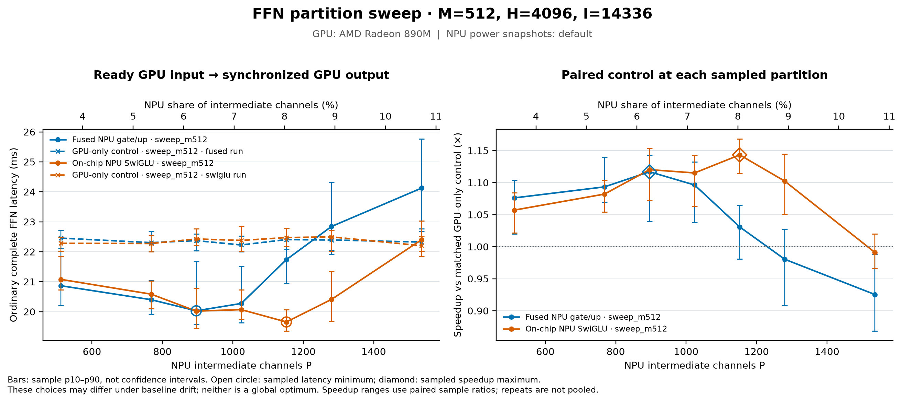

# On-chip SwiGLU experiment

**Measured:** the seven-partition main sweep's fastest SwiGLU point is
**P1152 at 19.657 ms**, versus its 22.474 ms GPU-only control: **1.1433×
speedup, or 12.53% lower latency**. Compared with the same sweep's best
three-launch combined gate/up point, P896 at 20.029 ms, the improvement is
**1.0189×, or 1.86% lower latency**. The independent reversed-order repeat
finds P1152 at **19.643 ms**, **1.1349×** its GPU-only control and **2.99%
lower latency** than the repeat's best three-launch point. P1024 is only
0.034 ms slower in that repeat; **P1024–P1152 is the useful candidate region**,
with P1152 the lowest sampled median in both blocks rather than a unique
optimal partition.

The new opt-in NPU graph combines gate,
up, SiLU and multiply, returning only `Z` before a separate down projection.
The NPU branch uses two launches rather than the previous combined
gate/up path's three. The GPU branch and final GPU partial-output sum are
unchanged. Architecture, ABI and resource constraints are in
[SWIGLU.md](../../npu/ffn/SWIGLU.md).

## Evidence available now

| Item | Status | Scope and limitation |
| --- | --- | --- |
| Local CPU verification | Passed: 102 tests (36 NPU, 66 experiment) | Schedule ownership, packed output addresses, host/runtime contracts, counters and report handling; not hardware execution |
| Small compiled-artifact audit | Passed: 661 static checks across 32 cores | Shared gate pools, DMA channels, linker allocation and ELF data; separate from runtime correctness |
| `M128/H128/P128` NPU checker | [60 checks passed](results/swiglu_fusion/exact_smoke.json) | Downloaded raw report; exact packed BF16 `Z` and complete NPU FFN comparisons against combined gate/up plus standalone pointwise |
| `M512/H4096/P384,P896` checker | [120 checks passed](results/swiglu_fusion/exact_m512.json) | Downloaded retry report; exact packed BF16 `Z` and complete NPU FFN comparisons |
| Initial full-size attempt | [Interrupted report preserved](results/swiglu_fusion/exact_m512_interrupted.json) | Saved status `preparing`, with zero checks; server stop cause unknown |
| Main ordinary complete-FFN comparison | Passed: 14 jobs, 1,260 timed calls | Seven partitions, two variants, 30 samples per mode; synthetic FFN only |
| Main stage diagnostics | Passed: 14 jobs, 140 timed calls | Separate 10-sample instrumented jobs; no independent internal SwiGLU stage timer |
| Reversed-order confirmation | Passed: eight ordinary jobs, 1,200 timed calls | P1280 → P1152 → P1024 → P896, both variants, 50 samples per mode; separate from the main block |
| Correctness-run power | All four downloaded before/after snapshots report `default` | Two boundaries around each completed checker; no performance-mode claim |

The full-size retry completed after the notebook restart. The container
identifier changed from `6402…` to `ba283b147d36`; no algorithm or driver was
changed as part of the restart. The server stop's cause is unknown, and the
interrupted zero-check attempt remains separate from the retry. Neither
correctness checker loads a language model: both use synthetic weights and
inputs. Correctness does not establish concurrent GPU–NPU acceleration,
model prefill, TTFT, attention overlap or Max+ 395 performance.

## What changes relative to combined gate/up

**Code-confirmed:** the NPU still owns `[0,P)` intermediate channels and the
GPU owns `[P,I)`. Matching gate/up output channels remain together through
pointwise work. Each branch down projection consumes its own K slice and
produces an `[M,H]` partial; the GPU adds the two partials after both are
ready. This experiment changes the NPU subgraph, not the partition algebra.

| Property | Combined gate/up baseline | On-chip SwiGLU candidate |
| --- | --- | --- |
| NPU sequence | Gate/up → SiLU/multiply → down | SwiGLU → down |
| Launches per branch call | 3 | 2 |
| Projection workers | 32 | 32 |
| Physical projection placement | Gate columns 0–3; up 4–7 | Gate/up adjacent pairs 0/1, 2/3, 4/5, 6/7 |
| Pointwise placement | Separate eight-column graph | The 16 up workers after their local full-K projection |
| Gate/up host output BOs | Two | None |
| Down-input layout | CPU | CPU |
| Down input | Host-staged compact `Z`, then conversion | Same |
| Fixed weight BO uploads | Two | Two; unchanged total packed weight bytes |
| Estimated explicit BO payload | `4MH + 12MP` bytes | `4MH + 4MP` bytes |

The candidate uses the unchanged projection arithmetic and SiLU/multiply
source, preserving BF16 storage after each projection, SiLU and multiply.
Adjacent FIFO handoff avoids requiring a third inbound DMA stream on an up
worker that already receives A and W. The runtime still reads `Z`, converts
its layout on CPU, and uploads it for down; only the gate/up-to-pointwise
portion stays on-chip.

The estimated BO reduction is `8MP` bytes per call: **3.5 MiB at
M512/P896**. That removes host gate/up readback and pointwise input writes.
It is a source-level payload estimate, not a measured reduction in physical
memory traffic. Launch count and bytes alone do not predict end-to-end
latency: NPU/GPU interference, CPU layout work and the completion boundary
remain in the timed path.

**Compiled-artifact confirmed:** the
[M128/H128/P128 audit](results/swiglu_fusion/compiler_audit/README.md)
finds exactly one shared 4 KiB gate pool per adjacent pair, located on the
even producer tile. Up workers read those buffers directly; no gate DMA
descriptors or compute-to-compute stream routes are emitted. Each core has
two input DMA channels for A/W, and only the odd cores have Z output DMA.
Static data SRAM including the reserved 2 KiB stack is 39,104 bytes per gate
core and 45,248 bytes per up/pointwise core, leaving 26,432 and 20,288 bytes
respectively. These are compiler allocation facts at the small shape, not
runtime stack, bank-contention or full-size performance measurements.

## Correctness gate before performance

`check_swiglu.py` compares combined gate/up plus standalone SiLU against
on-chip SwiGLU, using identical canonical unsigned W4A16 weights, group
size 128 and BF16 inputs. It exercises random A, different random B, zero and
repeat A. Both packed `Z` and complete NPU FFN output must match the
comparator **bit-for-bit**, while separate CPU-reference comparisons retain
the existing tolerance. Each graph must complete once per call and fixed
weights must be uploaded once. This prevents a successful launch, stale
output, aggregate counter or down-projection error cancellation from being
mistaken for correct fusion.

**Measured from the downloaded reports:** all 180 explicit checks pass.
There are 24 exact cross-variant BF16 comparisons (four inputs × two output
stages × three shapes), each with zero mismatched elements. Twelve further
exact comparisons verify repeat-input determinism within each variant.
Odd local channel-tile counts P384 and P896 therefore pass both the CPU
address/order tests and the device comparison.

| Shape | Explicit checks | Cross-variant exact comparisons | NPU completions, both variants | Max `Z` relative-L2 vs CPU | Max FFN relative-L2 vs CPU |
| --- | ---: | ---: | ---: | ---: | ---: |
| M128/H128/P128 | 60 | 8 | 20 | 0.002859 | 0.003318 |
| M512/H4096/P384 | 60 | 8 | 20 | 0.002766 | 0.003525 |
| M512/H4096/P896 | 60 | 8 | 20 | 0.002806 | 0.003556 |

Each shape executes four calls in each variant: 12 completed launches in
the three-launch comparator and eight in the two-launch candidate. The
total is **24 correctness-only branch calls and 60 completed launches**,
with each graph completing exactly once per call and every fixed weight BO
uploaded once. These are not timed performance samples. Both variants
produce the same outputs and thus the same CPU-reference errors; the maximum
recorded relative-L2 error is **0.003556**, below the unchanged 0.02 bound.
The maximum absolute `Z`/FFN errors are 0.125/0.0625 in the small case and
0.0625/0.03125 across the two full-size cases. All recorded finite, zero,
changed-input and repeat-input checks pass.

The independent [offline evidence audit](results/swiglu_fusion/exact_verification.json)
passes with no failures. It regenerates the seeded input and canonical
weight hashes, checks current checker/backend/reference and artifact
graph/kernel/planner source bindings, compares recorded output hashes,
and verifies runner increments, fixed weight uploads, array8 metadata and
the unchanged `rtol=0.03`, `atol=0.05`, relative-L2 bound 0.02. It also
verifies the power snapshots and preserved baseline archive. Raw device
output arrays and the full-size binaries were not downloaded; this is a
consistency/provenance audit of recorded hardware evidence, not an
independent hardware re-execution. Its retained
[verification script](results/swiglu_fusion/verify_exact.py) regenerates the
audit from the saved reports and seeded references.

## Main ordinary complete-FFN comparison

The [completed main sweep](results/swiglu_fusion/sweep_m512/sweep_manifest.json)
uses `M512/H4096/I14336`, the same weight/input seeds and
synthetic FFN contract as [FUSION_RESULTS.md](FUSION_RESULTS.md), with
P512/P768/P896/P1024/P1152/P1280/P1536. It compares combined gate/up and
on-chip SwiGLU using 30 ordinary samples per mode and 10 separate diagnostic
samples, after three warmups. Every ordinary job retains its own interleaved
GPU-only control and serialized branch control. Both NPU variants were
rerun in the current environment; old absolute timings are not used as the
control. The GPU path remains the original HeteroMosaic packed W4A16
dispatcher plus separate Torch BF16 SiLU/multiply, without teammate PR
kernel integration.

The timing boundary remains ready GPU input to synchronized GPU output. It
includes GPU input/output staging, NPU BO I/O, both NPU launches and waits,
CPU layouts and the GPU reduction. Compilation, weight setup and validation
readback remain outside that boundary.

All values below are **ordinary complete-FFN milliseconds**. Parentheses
show sample p10–p90 ranges, not confidence intervals. Speedup divides each
job's own GPU-only median by its concurrent median. The three-launch column
means combined gate/up followed by separate SiLU/multiply and down; the
two-launch column means on-chip SwiGLU followed by down.

| NPU P | Three-launch GPU control | Three-launch concurrent (p10–p90) | Speedup | Two-launch GPU control | Two-launch concurrent (p10–p90) | Speedup |
| ---: | ---: | ---: | ---: | ---: | ---: | ---: |
| 512 | 22.455 | 20.866 (20.216–22.013) | 1.0761× | 22.281 | 21.078 (20.734–21.850) | 1.0571× |
| 768 | 22.305 | 20.400 (19.905–21.044) | 1.0933× | 22.275 | 20.585 (20.104–21.022) | 1.0821× |
| 896 | 22.372 | **20.029 (19.584–21.680)** | **1.1170×** | 22.427 | 20.020 (19.452–20.781) | 1.1202× |
| 1024 | 22.226 | 20.275 (19.635–21.508) | 1.0963× | 22.379 | 20.069 (19.745–20.726) | 1.1151× |
| 1152 | 22.406 | 21.736 (20.952–22.791) | 1.0309× | 22.474 | **19.657 (19.360–20.062)** | **1.1433×** |
| 1280 | 22.393 | 22.842 (21.917–24.312) | 0.9803× | 22.496 | 20.409 (19.673–21.344) | 1.1023× |
| 1536 | 22.324 | 24.125 (22.763–25.769) | 0.9253× | 22.201 | 22.402 (21.849–23.034) | 0.9910× |



[PDF](results/swiglu_fusion/figures/total_ffn_m512_h4096_i14336.pdf),
[ordinary CSV](results/swiglu_fusion/figures/ordinary.csv) and
[plot summaries](results/swiglu_fusion/figures/summary.json) retain the source
values. GPU controls span 22.201–22.496 ms across this sweep; per-job controls
and sample ranges remain necessary on the shared host.

**Fixed-partition effect:** at P1152, on-chip pointwise fusion lowers the
median from 21.736 to 19.657 ms: 2.078 ms, or **9.56% lower latency**. At
P1280 it lowers latency by 10.65%. It also makes those larger NPU allocations
useful relative to their GPU controls. At P896, however, the difference is
only 0.009 ms (0.04%), much smaller than sample variability. At P512/P768,
the two-launch path is slightly slower despite faster NPU stage completion.
Removing a launch does not improve every complete-FFN allocation.

**After retuning each variant:** the appropriate comparison is the best
three-launch point P896 against the best two-launch point P1152. Its
observed advantage is 0.372 ms, or **1.86% lower latency**, not the 9.56%
fixed-P1152 improvement. P1152 assigns 8.04% of channels to the NPU, compared
with P896's 6.25%. The new minimum beats its paired GPU control in 29/30
iterations; the three-launch minimum does so in 30/30. All samples are
retained. These results identify a shifted allocation region; the separate
confirmation below checks whether that improvement survives another run.

The 28 main jobs pass **896 explicit checks** and all **1,400 timed calls**,
with **3,185 completed NPU launches** including checks and warmups. These
counts are separate from the 180 checks/60 launches in the exact-device
comparison. All 56 before/after snapshots report `default`. The
[main evidence audit](results/swiglu_fusion/sweep_analysis.json) verifies
report/power hashes, measurement sources, GPU sources and artifact contracts
with zero failures. The sweep has no full-model or attention-overlap workload.

## Measured diagnostic stages

`profile_timeline.py` runs separately for explanation, not as the ordinary
speedup measurement. SwiGLU diagnostics expose only `swiglu` and `down` NPU
launches. The composite SwiGLU interval cannot be split into internal
gate/up/SiLU/multiply compute from these probes. NPU host waits include
runtime/device scheduling, DMA, execution and completion notification;
they are not device-only compute. Explicit BO I/O and CPU layouts have
separate host intervals. HIP event time is a different clock, and medians
from separate stages are not additive.

The table uses the [three-launch P896](results/swiglu_fusion/sweep_m512/jobs/m512_p896_fused_diagnostic.json),
[three-launch P1152](results/swiglu_fusion/sweep_m512/jobs/m512_p1152_fused_diagnostic.json)
and [two-launch P1152](results/swiglu_fusion/sweep_m512/jobs/m512_p1152_swiglu_diagnostic.json)
reports. Values are medians in milliseconds across ten instrumented samples.
The front-stage and layout rows sum the relevant intervals **within each
invocation before taking the median**; other rows are individual intervals.

| Diagnostic interval | Three-launch P896 | Three-launch P1152 | Two-launch P1152 |
| --- | ---: | ---: | ---: |
| Instrumented complete FFN wall | 19.766 | 21.922 | 20.033 |
| Whole GPU branch, HIP events | 19.530 | 19.040 | 18.941 |
| NPU call including host work | 17.755 | 20.802 | 18.830 |
| Gate/up + pointwise, including BO I/O | 9.650 | 11.808 | 9.537 |
| NPU down, including BO I/O | 5.338 | 6.346 | 6.690 |
| CPU input/down-input/output layouts, sum | 2.384 | 2.079 | 1.814 |
| Output staging and boundary wait, host | 1.567 | 0.710 | 0.580 |
| NPU-output host→GPU copy, HIP events | 0.224 | 0.236 | 0.171 |
| Final GPU sum after dependencies, HIP events | 0.143 | 0.154 | 0.149 |

At fixed P1152, the diagnostic front-stage total falls from 11.808 to
9.537 ms while the complete NPU host call falls from 20.802 to 18.830 ms.
Down does not improve: its stage rises from 6.346 to 6.690 ms. The combined
change removes a pointwise dispatch and gate/up host BO round trips while
changing physical pointwise placement; the measurements do not isolate
which part of that change supplies each microsecond.

For the two-launch P1152 candidate, NPU submission medians are 97 µs for
SwiGLU and 185 µs for down; completion-wait medians are 8.779 and 5.673 ms.
The median sum of submission intervals per call is 0.283 ms, versus
0.377 ms in the three-launch P1152 diagnostic. API submission savings alone
therefore do not account for the entire front-stage difference, and these
intervals are not pure hardware launch costs. The CPU down-input layout
median is 0.102 ms; removing that permutation alone would leave the larger
projection, BO I/O and completion costs intact.

GPU projections remain prominent: at two-launch P1152, gate/up/down HIP
event medians are 6.622/5.879/5.684 ms; their per-sample summed share of the
GPU branch has a 96.06% median. GPU SiLU and multiply are 0.294/0.432 ms.
Within the common HIP event clock, the NPU-result copy starts after the GPU
branch ends in 8/10 P1152 SwiGLU samples, versus 10/10 in its three-launch
comparator. At P1536 it does so in all ten samples for both variants. This
locates the last dependency on the NPU/result-staging side in those samples;
it does not identify NPU compute versus DMA or host work as the cause.

At P512, fusion shortens the NPU host call from 15.314 to 13.301 ms but the
GPU branch event span rises from 20.516 to 20.774 ms, while the output-stage
host wait rises from 4.916 to 7.389 ms. The NPU-result copy finishes before
the GPU branch in all ten samples for both variants. This explains why
faster NPU completion need not reduce the boundary time at small shares.
Changes in overlap or shared-memory interference are possible explanations
for the GPU-span difference; no causal bandwidth or interference experiment
was performed.

The [GPU stage plot](results/swiglu_fusion/figures/stages_m512_h4096_i14336.pdf),
[NPU host-stage plot](results/swiglu_fusion/figures/npu_host_m512_h4096_i14336.pdf)
and [submission plot](results/swiglu_fusion/figures/submission_m512_h4096_i14336.pdf)
keep these timing domains separate. Instrumentation changes scheduling:
the P1152 candidate's diagnostic wall is 20.033 ms versus ordinary 19.657 ms.
Use the ordinary table for acceleration and these separate intervals for
bottleneck characterization.

## Independent reversed-order confirmation

The [completed ordinary-only block](results/swiglu_fusion/confirmation_m512/sweep_manifest.json)
runs P1280 → P1152 → P1024 → P896 for both variants, with 50 samples per
mode after three warmups. Variant order also alternates between points.
These reports remain separate from the main 30-sample block; no samples
are pooled and there are no additional diagnostic timings in this repeat.

| NPU P | Three-launch GPU control | Three-launch concurrent (p10–p90) | Speedup | Two-launch GPU control | Two-launch concurrent (p10–p90) | Speedup |
| ---: | ---: | ---: | ---: | ---: | ---: | ---: |
| 896 | 22.265 | **20.248 (19.716–21.033)** | **1.0996×** | 22.325 | 19.981 (19.536–20.430) | 1.1173× |
| 1024 | 22.428 | 20.671 (20.042–21.524) | 1.0850× | 22.234 | 19.677 (19.174–20.083) | 1.1300× |
| 1152 | 22.274 | 20.816 (20.390–21.896) | 1.0700× | 22.293 | **19.643 (19.216–20.840)** | **1.1349×** |
| 1280 | 22.245 | 22.305 (21.498–23.581) | 0.9973× | 22.232 | 20.301 (19.676–20.791) | 1.0951× |

All durations are ordinary complete-FFN milliseconds. The
[separate confirmation plot](results/swiglu_fusion/confirmation_figures/total_ffn_m512_h4096_i14336.pdf)
and [CSV](results/swiglu_fusion/confirmation_figures/ordinary.csv) retain
this block's controls and sample ranges.

The [independent-repeat graph](results/swiglu_fusion/comparison_figures/repeat_candidates_m512_h4096_i14336.pdf)
compares the same candidate points across blocks without pooling samples;
its [combined audit](results/swiglu_fusion/comparison_figures/combined_verification.json)
and [reproduction script](results/swiglu_fusion/compare_sweeps.py) are retained.

P1152 again has the lowest two-launch median, with **11.89% lower latency
than its own GPU control**. It beats that control in 48/50 paired iterations;
P1024, P896 and P1280 do so in 50/50, 49/50 and 50/50 respectively. The
three-launch minimum remains P896, winning 48/50 paired GPU comparisons.
At fixed P1152, the two-launch path is 5.64% lower in latency than the
three-launch path in this repeat, compared with 9.56% in the main block.
After retuning, the repeat's best-to-best advantage is **1.0308×, or 2.99%
lower latency** (20.248 → 19.643 ms).

P1024's two-launch median is only **0.034 ms (0.17%)** above P1152, within
the observed sample spread. P1024 also has a lower confirmation p90
(20.083 versus 20.840 ms); a median winner is not necessarily the best tail
latency choice. P1152 is a practical candidate for this host and
workload because it has the lowest median in both blocks, while P1024–P1152
should remain a configurable region. The evidence supports a modest
1.86–2.99% benefit over a retuned three-launch baseline, not a universal
partition optimum or the much larger fixed-P benefit at an unfavorable
three-launch allocation. Full-model prefill and concurrent attention still
need evaluation.

The repeat passes **280 explicit checks** and all **1,200 timed calls**, with
**2,280 completed NPU launches**. Its 16 power snapshots report `default`.
The [confirmation evidence audit](results/swiglu_fusion/confirmation_analysis.json)
has zero failures. Together, the two performance blocks contain **36 jobs,
2,600 timed calls, 1,176 explicit checks and 5,465 completed NPU launches**,
with 72 saved power boundaries. Adding the separate exact-device checker
gives 5,525 launches and 1,356 checks; its 24 correctness-only branch calls
are not added to the timed-call count. The retained
[sweep auditor](results/swiglu_fusion/analyze_sweep.py) reproduces each block's
hash, counter and summary verification. The 661 compiler checks and 102 CPU
tests are separate forms of evidence and are not included in those totals.

## Power and reproducibility

The available device is the previously observed Ryzen AI 9 HX370 / Radeon
890M / eight-column NPU2, not the proposed Max+ 395 platform. Earlier attempts
to request NPU `performance` mode were rejected, including under sudo; see
[POWER_TIMING.md](POWER_TIMING.md). Earlier fusion sweeps recorded `default`
before and after every process. New runs require fresh before/after XRT
platform snapshots, especially after the notebook restart. Boundary mode
snapshots do not measure continuous clocks, temperature or electrical power.

For the completed correctness runs, the saved [small-check before](results/swiglu_fusion/power_before_smoke.json)
and [after](results/swiglu_fusion/power_after_smoke.json) snapshots, plus the
[full-size retry before](results/swiglu_fusion/power_before_exact_retry.json)
and [after](results/swiglu_fusion/power_after_exact_retry.json) snapshots, all
identify NPU Strix with eight columns and report `power_mode: default`.

The previous 26 measurement sources were preserved before adding SwiGLU:

- [Archive](results/swiglu_fusion/baseline_sources.tar.gz).
- [Per-file and archive SHA-256 manifest](results/swiglu_fusion/baseline_source_manifest.json).
- [Earlier main sweep manifest](results/fusion_sweep_m512/sweep_manifest.json).

The archive hash and all 26 file hashes were verified, and those hashes
match the earlier main sweep. Current runtime/profiling files have since
changed to support SwiGLU. Reproduce the old result using the preserved
source snapshot rather than assuming current file hashes still match it.
New measurement manifests must record their own current source hashes,
artifact bindings, reports and power snapshots. The compiler remains pinned
to MLIR-AIE `7e00b57955e108fe9d8e9419f5828a0c7e650858`.

## Reproduction commands

The commands below reproduce the recorded full-size check and main sweep.
Use the prepared runtime and separate IRON
interpreter from [README.md](README.md). Save power queries before and after
the checker; the sweep driver captures them around each benchmark process.

```bash
export OPENBLAS_NUM_THREADS=1 OMP_NUM_THREADS=1
/notebooks/heteromega-ffn-venv/bin/python \
  -m experiments.ffn_partition.check_swiglu \
  --m 512 --hidden 4096 --channels 384 896 \
  --iron-python /home/mliraie/mlir-aie/ironenv/bin/python \
  --output experiments/ffn_partition/results/swiglu_fusion/exact_m512.json
```

After a verified correctness pass, a fresh comparison can use:

```bash
/notebooks/heteromega-ffn-venv/bin/python \
  -m experiments.ffn_partition.sweep_partition \
  --m 512 --hidden 4096 --intermediate 14336 \
  --npu-channels 512,768,896,1024,1152,1280,1536 --variants fusion-levels \
  --iterations 30 --diagnostic-iterations 10 --warmup 3 \
  --iron-python /home/mliraie/mlir-aie/ironenv/bin/python \
  --required-power-mode default \
  --output-dir experiments/ffn_partition/results/swiglu_fusion/comparison_m512
```

The required mode must match a fresh observed setting; the flag validates
it and does not configure power. Use a new output directory for a new run.
Do not resume across changed measurement sources or merge incomplete and
completed reports into one result. For individual runs, ordinary and
diagnostic CLIs both accept `--fuse-swiglu`, which implies `--fuse-gate-up`.
